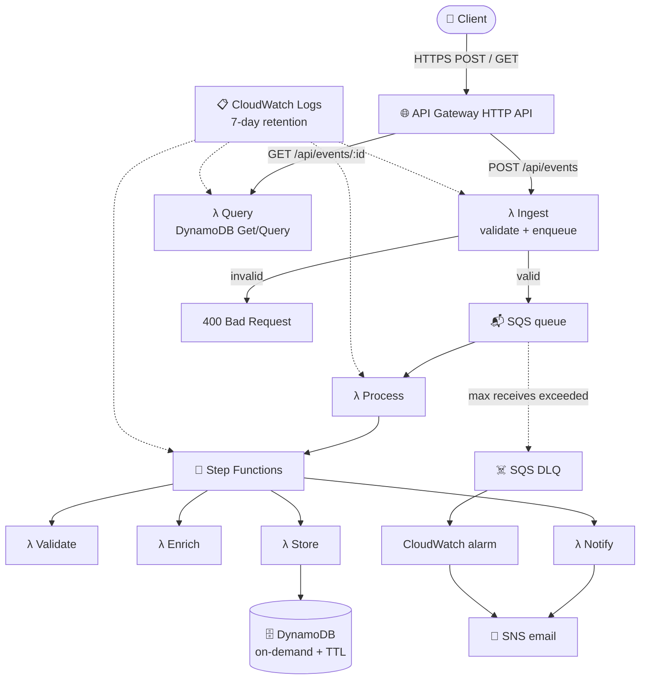
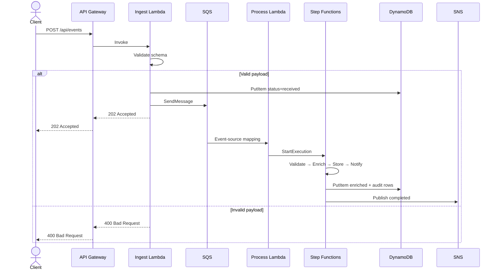
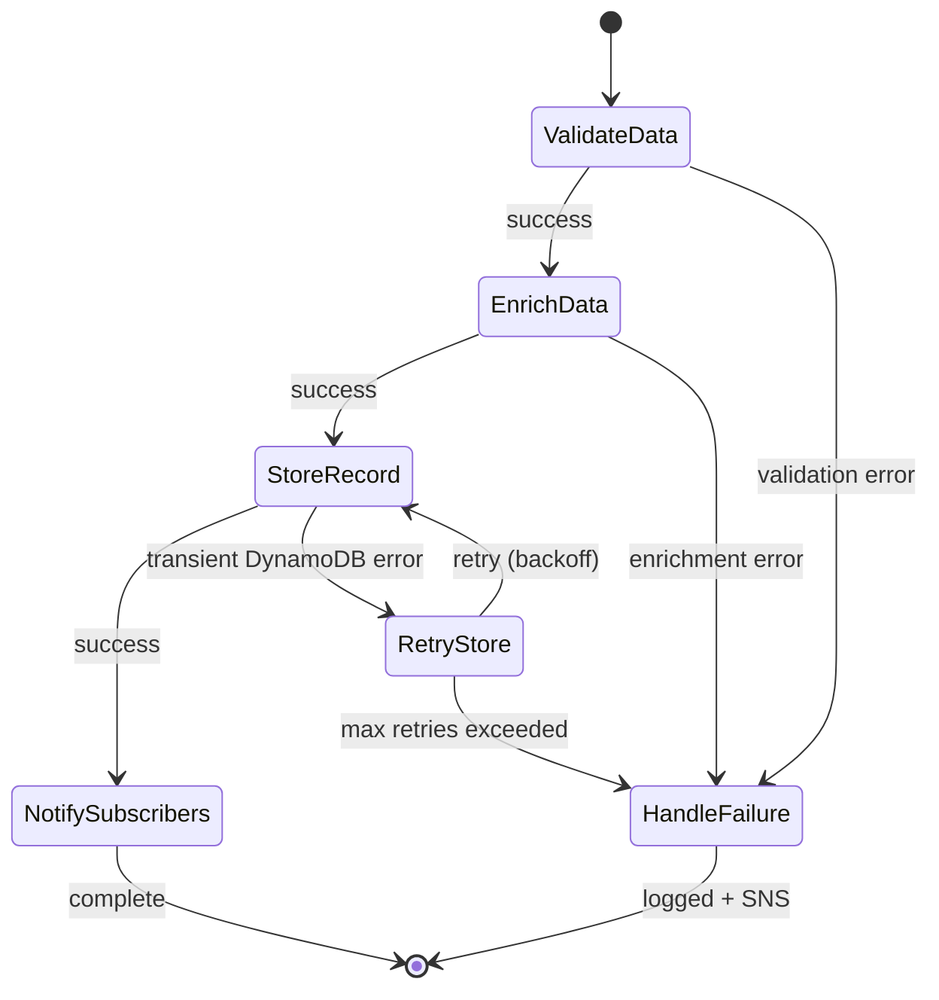
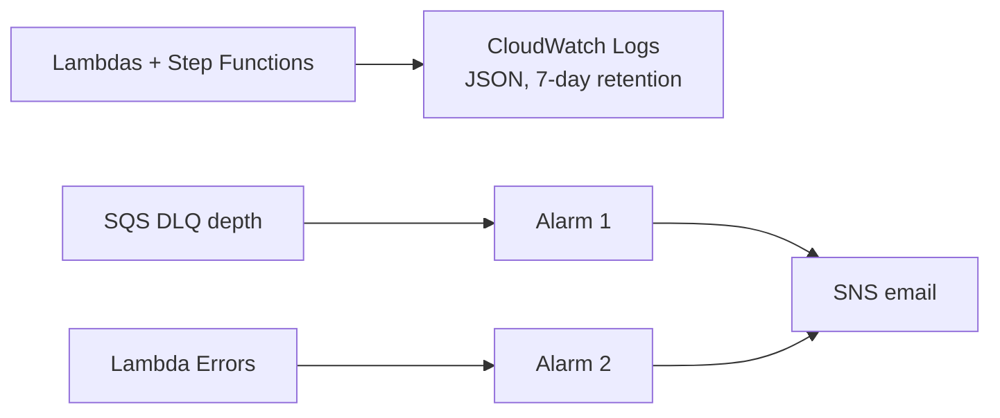

<div align="center">

# 🌩️ NimbusFlow

### Serverless Event-Driven Data Pipeline on AWS

_Data in, insight out — scales to zero, so the lab costs nothing when you are not calling it._

[](#)
[](#)
[](#)
[](#)
[](#)
[](#)
[](#license)

</div>

---

## 🧭 Table of Contents

- [🔍 Overview](#-overview)
- [📌 Project Status](#-project-status)
- [✨ Key Features](#-key-features)
- [💰 Cost \& Free Tier](#-cost--free-tier)
- [🏗️ System Architecture](#️-system-architecture)
- [🔄 Event Flow](#-event-flow)
- [🧭 Step Functions Workflow](#-step-functions-workflow)
- [🗃️ Data Model](#️-data-model)
- [🔑 IAM \& Security](#-iam--security)
- [🔬 Observability](#-observability)
- [🧰 Tech Stack](#-tech-stack)
- [📁 Project Structure](#-project-structure)
- [📡 API Reference](#-api-reference)
- [🚀 Getting Started](#-getting-started)
- [⚙️ Configuration](#️-configuration)
- [☁️ Deployment](#️-deployment)
- [📄 License](#-license)

**Spec version:** 1.1 — 2026-09-07 (same version as [`TODO.md`](./TODO.md))

---

## 🔍 Overview

**NimbusFlow** is a fully serverless event pipeline on AWS. A client posts an event to API Gateway; a Lambda validates it and drops it on SQS; another Lambda starts a Step Functions workflow that validates, enriches, stores the record in DynamoDB, and publishes to SNS.

There are no servers to patch and **no idle bill**. Nothing runs until a request arrives.

> **Built for:** a Cloud Engineer portfolio piece you can actually finish at $0 — IAM, queues, orchestration, IaC, and failure paths — without ALB, Fargate, RDS, or a NAT Gateway.

---

## 📌 Project Status

This README is the **finished project**. [`TODO.md`](./TODO.md) is the only build list — every checkbox is in scope. There is no roadmap.

When the TODO is done, NimbusFlow is done:

- `POST /api/events` → Ingest Lambda → SQS → Process Lambda → Step Functions
- Step Functions: Validate → Enrich → Store (DynamoDB) → Notify (SNS)
- `GET /api/events/:id` for status + audit items
- SQS dead-letter queue for poison messages
- JSON logs in CloudWatch (7-day retention)
- Two alarms: Lambda errors, DLQ depth → SNS email
- AWS SAM for the whole stack
- Least-privilege IAM per function

---

## ✨ Key Features

| Feature                       | Description                                                                                                        |
| ----------------------------- | ------------------------------------------------------------------------------------------------------------------ |
| ⚡ **Fully serverless**       | No EC2, no containers — Lambda, API Gateway, DynamoDB, Step Functions                                              |
| 🔄 **Decoupled ingest**       | SQS sits between the API and the workflow so a burst does not stampede DynamoDB                                    |
| 🧭 **Explicit workflow**      | Step Functions makes validate → enrich → store → notify visible and retryable                                      |
| 🛡️ **Failure paths**          | Invalid requests get `400`. Step Functions retries, then marks `failed` + SNS. SQS DLQ is for poison messages only |
| 🗄️ **Single-table DynamoDB**  | Event + audit items under one partition key; TTL expires old rows                                                  |
| 🧱 **Infrastructure as code** | Entire stack in AWS SAM (`template.yaml`)                                                                          |
| 💵 **Scales to $0**           | Idle cost is zero. Stay inside always-free monthly caps (see [Cost](#-cost--free-tier))                            |

---

## 💰 Cost & Free Tier

**Yes — this project is designed to cost $0** if you stay inside the rules below. Unlike CloudLedger, nothing here bills just for existing.

### Always-free at portfolio volume

| Service                   | Why it stays $0                                                  |
| ------------------------- | ---------------------------------------------------------------- |
| Lambda                    | 1M requests/month always free                                    |
| DynamoDB                  | 25 GB + modest read/write always free                            |
| SQS                       | 1M requests/month always free                                    |
| SNS (email)               | First 1,000 email deliveries/month free                          |
| Step Functions (Standard) | **4,000 state transitions/month** always free                    |
| IAM, CloudFormation, SAM  | $0                                                               |
| CloudWatch Logs           | Stay under the always-free ingest cap; **7-day retention**       |
| CloudWatch Alarms         | **2 alarms** (10 are free)                                       |
| AWS Budgets               | First budgets are free — create a **$1** alarm before you deploy |

API Gateway at a few hundred demo calls is **$0.00** on the bill even when it is not an “always-free” service.

### Hard rules (this is the whole project — do not add more)

1. **Do not load-test.** One Step Functions execution uses several transitions. A burst can burn the 4,000/month free allotment.
2. **No custom EventBridge bus.** Extra bus + rules are how “free serverless” starts billing.
3. **No X-Ray, no extra dashboards, no S3.**
4. **No Route 53 / custom domain.** Use the API Gateway default URL.
5. **No Slack webhook product.** SNS email only.
6. **One stack.** A second “prod” stack doubles everything — wait until you have credits.
7. **Delete the stack when you are done demoing** (`sam delete`). Idle is $0; leftover log groups with no retention are how pennies appear.

Set the $1 budget first. If you follow this list, you should not pay.

---

## 🏗️ System Architecture



**Design principles:**

- **Decouple ingest from work** — the API returns `202` as soon as the message is on SQS.
- **Orchestrate, don't chain Lambdas by hand** — Step Functions owns retries and `Catch`.
- **Invalid input is not a DLQ event** — bad JSON is `400` at ingest. The DLQ is for messages that fail processing after retries.
- **No EventBridge** — notify is SNS.

---

## 🔄 Event Flow



---

## 🧭 Step Functions Workflow



- Transient DynamoDB errors retry with backoff, then fail.
- Every state has a `Catch`. Failures update the item to `failed` and publish to SNS. They do not vanish.
- Keep executions rare (manual demos only) so you stay under 4,000 transitions/month.

---

## 🗃️ Data Model

One table. Event metadata and audit rows share a partition key. **No S3.** Keep payloads small (a few KB).

```mermaid
erDiagram
    EVENTS {
        string PK "EVENT#<event_id>"
        string SK "METADATA"
        string event_type
        string status "received | processing | stored | failed"
        map payload
        number created_at
        number ttl
    }

    EVENT_AUDIT {
        string PK "EVENT#<event_id>"
        string SK "AUDIT#<timestamp>"
        string stage "validate | enrich | store | notify"
        string result
        number timestamp
    }

    EVENTS ||--o{ EVENT_AUDIT : "tracked by"
```

- `GET /api/events/:id` queries `PK = EVENT#<id>` and returns metadata + audit items.
- TTL on `METADATA` expires old events so the table stays inside the free 25 GB cap.

---

## 🔑 IAM & Security

Each Lambda gets its own role. No wildcard resource ARNs.

| Function          | Allowed actions                           | Resource               |
| ----------------- | ----------------------------------------- | ---------------------- |
| Ingest            | `sqs:SendMessage`, `dynamodb:PutItem`     | This queue, this table |
| Process           | `states:StartExecution`                   | This state machine     |
| Validate / Enrich | (none beyond logs — CPU only)             | —                      |
| Store             | `dynamodb:PutItem`, `dynamodb:UpdateItem` | This table             |
| Notify            | `sns:Publish`                             | This topic             |
| Query             | `dynamodb:GetItem`, `dynamodb:Query`      | This table             |

The API is the default HTTP API URL (no custom domain). No Cognito, no API keys, no SSM secrets.

---

## 🔬 Observability

Observability is **logs + two alarms**. Not X-Ray. Not a dashboard.



- Structured JSON logs (`eventId`, `stage`, `result`) so you can grep one request without a trace map.
- Alarm 1: DLQ `ApproximateNumberOfMessagesVisible` > 0.
- Alarm 2: Ingest or Process `Errors` > 0.

---

## 🧰 Tech Stack

| Layer             | Technology                | Purpose                                |
| ----------------- | ------------------------- | -------------------------------------- |
| **API**           | API Gateway HTTP API      | `POST` / `GET` entry                   |
| **Compute**       | AWS Lambda (TypeScript)   | Ingest, process, workflow steps, query |
| **Orchestration** | Step Functions (Standard) | Validate → enrich → store → notify     |
| **Queue**         | SQS + DLQ                 | Async handoff + poison messages        |
| **Database**      | DynamoDB (on-demand)      | Event + audit items                    |
| **Notify**        | SNS email                 | Completion and alarm mail              |
| **Logs**          | CloudWatch Logs           | JSON logs, 7-day retention             |
| **IaC**           | AWS SAM                   | One `template.yaml`                    |

---

## 📁 Project Structure

```
nimbusflow/
├── functions/
│   ├── ingest/handler.ts
│   ├── process/handler.ts
│   ├── validate/handler.ts
│   ├── enrich/handler.ts
│   ├── store/handler.ts
│   ├── notify/handler.ts
│   └── query/handler.ts
├── statemachine/
│   └── pipeline.asl.json
├── events/                      # Sample payloads for sam local
├── tests/
│   ├── unit/
│   └── integration/
├── template.yaml
├── samconfig.toml
├── LICENSE
├── TODO.md
└── README.md
```

---

## 📡 API Reference

Base URL: the API Gateway default URL + `/api`.

| Method | Endpoint          | Description                                     |
| ------ | ----------------- | ----------------------------------------------- |
| `POST` | `/api/events`     | Enqueue an event (`202`). Invalid body → `400`. |
| `GET`  | `/api/events/:id` | Metadata + audit trail                          |

There is no separate `/audit` route — audit rows come back on the GET.

**Example** — `POST /api/events`

```json
{
  "eventType": "order.created",
  "payload": {
    "orderId": "ord_8821",
    "amount": 249.0
  }
}
```

```json
{
  "eventId": "evt_5f2a9c",
  "status": "received",
  "acceptedAt": "2026-09-07T14:32:10Z"
}
```

Keep `payload` small. Do not attach files.

---

## 🚀 Getting Started

### Prerequisites

- AWS CLI
- AWS SAM CLI
- Node.js ≥ 18
- Docker (for `sam local`)
- A **$1 AWS Budget** email alarm already on the account

### Local Development

```bash
git clone https://github.com/your-org/nimbusflow.git
cd nimbusflow
npm install
sam build
sam local invoke IngestFunction --event events/sample-event.json
sam local start-api
```

Submit a handful of events by hand. Do not script a flood.

---

## ⚙️ Configuration

| Name                | Where        | Purpose                       |
| ------------------- | ------------ | ----------------------------- |
| `EVENTS_TABLE_NAME` | Function env | DynamoDB table                |
| `EVENTS_QUEUE_URL`  | Function env | Ingest → process queue        |
| `STATE_MACHINE_ARN` | Function env | Process starts this execution |
| `ALERT_TOPIC_ARN`   | Function env | SNS email                     |
| `LOG_LEVEL`         | Function env | `info` / `debug`              |

No `EVENT_BUS_NAME`. No AWS access keys in env — Lambda roles provide credentials.

---

## ☁️ Deployment

**Prerequisites on the machine:** AWS CLI, AWS SAM CLI, Docker (for `sam build`/`sam local`), and credentials (`aws sts get-caller-identity` should succeed). Create a **$1** budget first.

`samconfig.toml` is committed with stack name `nimbusflow`, but **`NotificationEmail` is still the placeholder `you@example.com`**. Replace it with your address before deploy (or pass it during `--guided`).

```bash
# 1. Fix the email in samconfig.toml (parameter_overrides)
# 2. Validate + build + deploy
sam validate --lint
sam build
sam deploy --guided    # first time — saves real params into samconfig.toml
sam deploy             # later deploys
```

`template.yaml` creates the HTTP API, functions, state machine, SQS + DLQ, DynamoDB table, SNS topic, two alarms, and IAM roles. Confirm the SNS subscription email in your inbox.

### Smoke test (after deploy)

```bash
npm test                                          # unit tests (no AWS)
npm run smoke -- https://<api-id>.execute-api.<region>.amazonaws.com
```

The smoke script posts one event, polls GET until `stored`, then asserts a bad body returns `400`. Three requests total — not a load test.

After a demo:

```bash
sam delete
```

Rollback of a bad deploy is the previous CloudFormation stack event / `sam delete` + redeploy.

**Status:** code + unit tests are ready; live `sam build` / `sam deploy` still need AWS CLI, SAM CLI, and real credentials on the deploy machine.

---

## 📄 License

Distributed under the MIT License. See `LICENSE` for more information.

<div align="center">

**NimbusFlow** — Lambda, API Gateway, Step Functions, DynamoDB, SQS, SNS, CloudWatch — idle cost $0

Spec 1.1 — 2026-09-07

</div>
